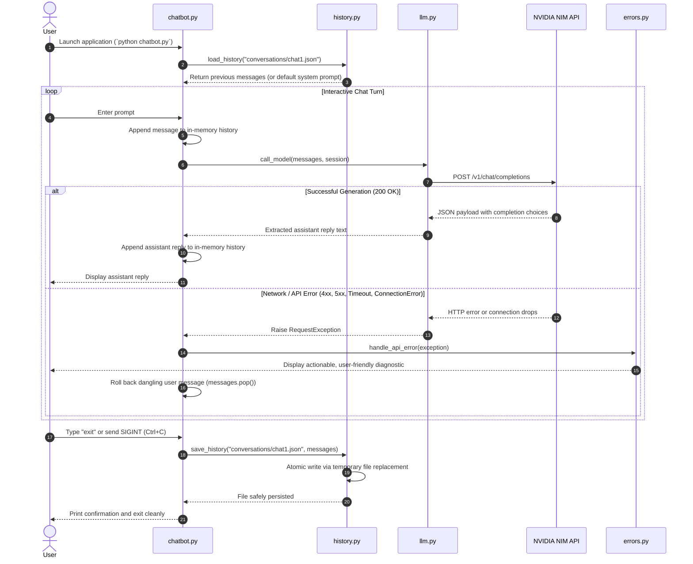

# API Explorer

A lightweight, robust command-line interface for communicating with NVIDIA NIM hosted LLM endpoints (such as `meta/llama-3.1-8b-instruct`). It features atomic multi-turn conversation persistence across sessions, strict PEP 484 static typing, connection pooling, and resilient exception handling with automatic transactional rollback.

---

## Architecture & Workflow

### Request-Response & Error Recovery Flow



### Module Component Topology

```
+-------------------------------------------------------------+
|                          chatbot.py                         |
|   (Interactive CLI Loop, Signal Handlers, Connection Pool)  |
+--------------+----------------------+-----------------------+
               |                      |
               v                      v
      +------------------+   +------------------+
      |    history.py    |   |      llm.py      |
      | (JSON I/O & Safe |   | (NIM Client,     |
      |   Atomic Writes) |   |  Payload Schema) |
      +--------+---------+   +--------+---------+
               |                      |
               |                      v
               |             +------------------+
               |             |    errors.py     |
               |             | (Friendly Error  |
               |             |  Diagnostics)    |
               |             +------------------+
               v                      v
      +-----------------------------------------+
      |                config.py                |
      |   (Environment Variables, Defaults,    |
      |       Paths & Validation Checks)        |
      +-----------------------------------------+
```

---

## File Responsibilities

| File | Primary Responsibility | Key Functions & Interfaces |
|---|---|---|
| `config.py` | Central configuration, environment variables, default model settings, and file paths. | `get_api_key()`, `validate_config()` |
| `llm.py` | Dispatches completions to the NVIDIA NIM endpoint, manages headers, payloads, and response validation. | `call_model()` |
| `errors.py` | Maps low-level requests and HTTP exceptions to structured, human-readable guidance. | `format_api_error()`, `handle_api_error()` |
| `history.py` | Manages JSON conversation persistence with atomic temporary file swapping and schema validation. | `load_history()`, `save_history()` |
| `chatbot.py` | Main CLI entry point, session lifecycle manager, connection pooling, and interactive chat loop. | `run_chat()`, `main()` |
| `conversations/chat1.json` | Active conversation history stored as JSON. | Multi-turn message schema |
| `example.json` | Reference JSON template showing the standard conversation serialization format. | Sample message schema |

---

## Error Handling & Recovery Matrix

When network disruptions or API errors occur, `chatbot.py` catches `requests.exceptions.RequestException`, delegates user messaging to `errors.py`, and immediately rolls back the unsent user message from memory. This guarantees the chat history is never left in an inconsistent state.

| Exception Type | Trigger Condition | User Guidance Provided | Conversation State Action |
|---|---|---|---|
| `Timeout` | Server response took > 20s | Server may be busy; suggests retrying. | Prompt rolled back; state intact |
| `ConnectionError` | DNS resolution failure or no network | Check internet connectivity. | Prompt rolled back; state intact |
| `HTTPError 401` | Missing or invalid `NVIDIA_API_KEY` | Authentication failed; verify API key. | Prompt rolled back; state intact |
| `HTTPError 403` | NVIDIA account unverified or restricted | Access denied; verify account status. | Prompt rolled back; state intact |
| `HTTPError 404` | Invalid endpoint URL or deprecated model | Endpoint or model name not found. | Prompt rolled back; state intact |
| `HTTPError 429` | Rate limit threshold exceeded | Rate limit reached; wait before retry. | Prompt rolled back; state intact |
| `HTTPError 5xx` | NVIDIA backend server errors | Server issues; retry in a few moments. | Prompt rolled back; state intact |
| `JSONDecodeError` | Corrupted conversation file on disk | Warns user and initializes fresh session. | Fresh session initiated |
| `KeyboardInterrupt` | User presses `Ctrl+C` | Graceful exit banner; persists session. | Atomically saved to disk |

---

## Quickstart & Usage

### 1. Requirements

- Python 3.9+
- NVIDIA NIM API Key ([get one from NVIDIA](https://build.nvidia.com))

### 2. Installation

Clone the repository and install dependencies:

```bash
# Clone the repository
git clone <repository-url>
cd api_explorer

# Create and activate virtual environment
python3 -m venv .venv
source .venv/bin/activate  # On Windows: .venv\Scripts\activate

# Install required dependencies
pip install -r requirements.txt

# Or install editable project with dev dependencies
pip install -e ".[dev]"
```

### 3. Environment Setup

Create a `.env` file in the project root:

```bash
echo 'NVIDIA_API_KEY="nvapi-your-key-here"' > .env
```

Alternatively, export the environment variable in your active terminal:

```bash
export NVIDIA_API_KEY="nvapi-your-key-here"
```

### 4. Running the Chatbot

Start the interactive session:

```bash
python chatbot.py
```

- Type your message and press **Enter** to chat.
- Type `exit` or `quit` to end the session.
- Pressing `Ctrl+C` or `Ctrl+D` safely saves the chat before exiting.

---

## Conversation Storage Format

Conversations are serialized atomically to `conversations/chat1.json`. If this file does not exist, a new conversation with a default system prompt is created.

Sample schema (`example.json`):

```json
[
  {
    "role": "system",
    "content": "You are a helpful assistant."
  },
  {
    "role": "user",
    "content": "Hello! Can you explain what API Explorer does?"
  },
  {
    "role": "assistant",
    "content": "API Explorer is a lightweight command-line chatbot interface for NVIDIA's hosted LLM endpoints with persistent conversation history and robust error handling."
  }
]
```

---

## Verification & Quality Benchmarks

The refactored codebase is tested with `pytest`, checked with `ruff`, and verified with `mypy` under strict settings.

### Test Execution & Code Coverage Summary

```bash
pytest --cov=. --cov-report=term-missing
```

| Module | Statements | Missing Lines | Coverage | Status |
|---|:---:|:---:|:---:|:---:|
| `config.py` | 33 | 0 | **100%** | Passed |
| `errors.py` | 30 | 0 | **100%** | Passed |
| `llm.py` | 34 | 0 | **100%** | Passed |
| `chatbot.py` | 62 | 1 (`__main__` entry) | **98%** | Passed |
| `history.py` | 48 | 3 (OS file unlink catch) | **94%** | Passed |
| `tests/` (all 5 suites) | 337 | 0 | **100%** | Passed |
| **Total Codebase** | **544** | **4** | **99%** | **Passed (49/49)** |

### Static Analysis & Linter Verification

| Tool | Rule Suite / Configuration | Result |
|---|---|---|
| **pytest** | 49 test cases covering unit, edge-case, and integration flows | **49 passed in ~0.15s** |
| **ruff check** | Strict PEP 8, flake8 (E, W, F, B, UP), and isort imports | **All checks passed (0 errors)** |
| **ruff format** | PEP 8 conforming code formatting | **12 files cleanly formatted** |
| **mypy** | Strict typing (`check_untyped_defs`, `disallow_untyped_defs`) | **Success (0 issues across all files)** |
